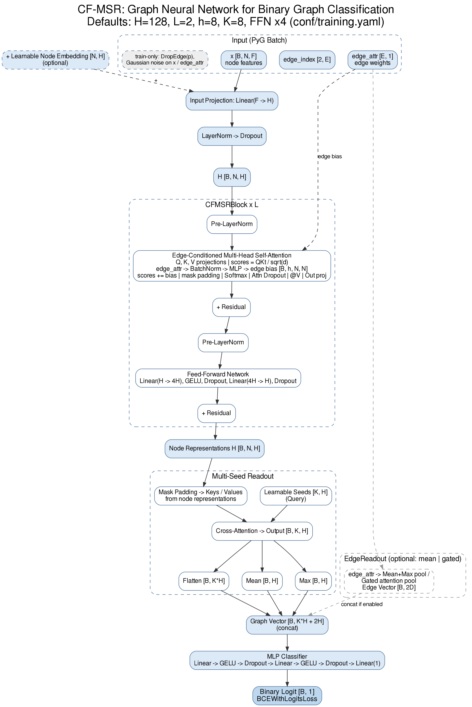

# CF-MSR

Обучение графовой модели **CF-MSR** (edge-aware transformer + multi-seed readout) для бинарной классификации на данных рассеянного склероза.

Вход: табличный CSV с признаками узлов и CSV-файлы графов (веса рёбер по образцам). Конфигурация — **Hydra**. Поиск гиперпараметров — **Hydra Optuna Sweeper**, трекинг экспериментов — **MLflow** (SQLite).

> **Данные не входят в репозиторий**: пути к CSV задаются в `conf/data.yaml` (см. [Данные](#данные)). В репозиторий также не коммитятся артефакты прогонов (`outputs/`, `mlruns/`, `*.pt`, predictions-CSV, базы MLflow/Optuna) — см. `.gitignore`.

## Содержание

- [Быстрый старт](#быстрый-старт)
- [Текущее состояние](#текущее-состояние)
- [Требования](#требования)
- [Структура](#структура)
- [Данные](#данные)
- [Архитектура модели](#архитектура-модели)
- [Конфигурация](#конфигурация)
- [Запуск](#запуск)
- [Пресеты экспериментов](#пресеты-экспериментов)
- [Протокол оценки](#протокол-оценки)
- [Базлайны](#базлайны-проверка-сигнала)
- [Кросс-валидация](#кросс-валидация)
- [Подбор гиперпараметров](#подбор-гиперпараметров)
- [Метрики и регуляризация](#метрики-и-регуляризация)
- [Тесты](#тесты)

## Текущее состояние

Подробный журнал экспериментов и план дальнейших шагов — в [`hp_plan.md`](hp_plan.md).

Все метрики — ROC-AUC. CV: среднее по fold (± std по fold), OOF — AUC по пулу предсказаний вне обучения, holdout — отдельный тест (≈ 290 образцов), 95% ДИ — bootstrap по образцам.

### Лучшие результаты по моделям

| Модель / run (MLflow) | Схема CV | CV | OOF | Holdout (95% ДИ) |
|-----------------------|----------|----|-----|------------------|
| CF-MSR, до признаков из рёбер (A0) | stratified | 0.533 ± 0.049 | — | — |
| CF-MSR, признаки из рёбер + 30% рёбер (A1) | stratified | 0.638 ± 0.044 | — | — |
| CF-MSR `best_hpo` (`best_w_holdout`, `best_seeds`, `best_holdout_ensemble`) | stratified | 0.67–0.70 | 0.706–0.714 | **0.615** (0.543–0.682) |
| CF-MSR `best_hpo` (`best_fold_column`) | fold_column | 0.714 ± 0.070 | 0.712 (0.664–0.755) | — |
| CF-MSR `best_hpo`, `num_layers=2` (`best_fold_column_2layers`) | fold_column | 0.706 ± 0.078 | 0.728 (0.686–0.770) | — |
| CF-MSR `best_hpo`, `num_layers=2`, stats `mean,std,max,min`, 5 seed (`best_fold_column_2l_ho`) | fold_column | **0.736 ± 0.036** | **0.744** (0.706–0.786) | 0.574 (0.506–0.645) |
| SkipGCN (порт HCP_GCN), ансамбль 5 fold | stratified | 0.570 ± 0.023 | 0.558 (0.508–0.608) | 0.610 (0.542–0.675) |
| logreg на `edge_nodes` (variance 0.2, `mean,std`) | repeated CV | 0.626 ± 0.044 | — | 0.582 |
| logreg на `edges` + `mutual_info` 0.2 (`best`) | repeated CV, **с утечкой отбора** | 0.754 ± 0.040 | — | 0.592 (val 0.679) |

SkipGCN, single-split (без CV): val 0.51 / 0.48, holdout 0.41 (`hidden_channels=15`, `lr=1e-3`) и 0.61 (`hidden_channels=32`, `lr=3e-4`). Разброс между запусками показывает, что single-split оценке доверять нельзя.

> **Утечка в CV logreg.** `baseline.py` отбирает рёбра (`mutual_info`, зависит от меток) по train-части, а затем считает repeated CV на train+val. Метки части fold'ов попадают в отбор, поэтому 0.754 завышено. Честные оценки у этой модели — val 0.679 и holdout 0.592. CV GNN отбор пересчитывает внутри каждого fold (`prepare_split`) и такой утечки не имеет. Отбор `variance` меток не использует, поэтому строка `edge_nodes` корректна.

### Главное

- Основной вклад дали признаки узлов из рёбер (`edge_node_features`) и отбор рёбер (`edge_selection.keep_ratio` 0.1–0.2), затем рост `lr` до ≈ 2e-3.
- Остальные архитектурные оси (эмбеддинг узлов, `edge_readout`, `edge_scaler`, `weight_decay`, `drop_edge`, шум) на качество не влияют в пределах шума.
- Переобучения нет: на лучшей эпохе train AUC ≈ val AUC (`best_hpo`: 0.64 / 0.71; 2 слоя + 4 статистики: 0.70 / 0.74). Лучшая эпоха — в среднем 12–18-я.
- `fold_column` CV не ниже stratified (0.71 против 0.67–0.70). Значит, разрыв CV → holdout определяется данными, а не схемой разбиения.
- Самая высокая оценка CV (0.736, 2 слоя + `max,min`) дала **худший** holdout (0.574). SkipGCN с CV 0.57 дал holdout 0.61. На CV и holdout модели упорядочиваются по-разному, CV не предсказывает holdout.
- Все holdout-оценки (0.57–0.62) лежат внутри ДИ шириной ≈ 0.14 и статистически не различаются. Реалистичный потолок на текущих данных — holdout ≈ 0.6.
- Лучший fold-ориентир по CV — `best_fold_column_2l_ho`. Лучший по holdout — `best_hpo` на stratified (`best_holdout_ensemble`, 0.615). Различие значимым не считать.
- Эффект 2 слоёв и статистик `max,min` в `best_fold_column_2l_ho` не разделён: менялись оба параметра, плюс число seed 3 → 5.
- Fold 0 `fold_column` — самый трудный (AUC 0.59 у `best_hpo`, 0.72 у 2l_ho). Большая часть std по fold объясняется им.

### Использование holdout

Holdout уже посчитан трижды: `best_holdout_ensemble` (CF-MSR), `best_fold_column_2l_ho` (CF-MSR) и SkipGCN. Выбирать модель или параметры по нему дальше нельзя. Для отбора — только CV (`cv.evaluate_holdout=false`).

Ближайшие шаги: честное сравнение с logreg (отбор рёбер внутри fold'ов), разделение эффекта числа слоёв и статистик `max,min` на CV, проверка гипотезы о сдвиге распределения между OOF-рёбрами train+val и рёбрами holdout. Подробности — в [`hp_plan.md`](hp_plan.md).

## Требования

- Python ≥ 3.12
- CUDA-совместимый PyTorch (опционально, иначе CPU)

```bash
pip install -r requirements.txt
```

Основные зависимости: `torch`, `torch-geometric`, `hydra-core`, `hydra-optuna-sweeper`, `optuna`, `mlflow`, `pandas`, `scikit-learn`, `pytest`.

> Optuna 2.x + SQLite требуют `sqlalchemy>=1.4,<2`. Поэтому MLflow ограничен `<3`: MLflow 3.x в UI падает с `AttributeError: module 'sqlalchemy' has no attribute 'Engine'`.

Проверенное окружение: Python 3.12, `torch` 2.5 + `torch-geometric` 2.6 (CUDA-сборка; на CPU тоже работает, но медленнее).

## Быстрый старт

```bash
git clone <repo-url> && cd CF-MSR
pip install -r requirements.txt
```

1. Укажите свои данные в `conf/data.yaml` (формат — см. [Данные](#данные)):
   `data_csv`, `train_valid_graphs_csv`, `holdout_graphs_csv`, `target_col`.
2. Проверьте окружение и тесты:
   ```bash
   pytest tests/ -q
   ```
3. Короткий пробный запуск (2 эпохи, без MLflow):
   ```bash
   python main.py training.epochs=2 mlflow.enabled=false
   ```
4. Полноценный запуск:
   ```bash
   python main.py +experiment=best_hpo
   ```

## Структура

```
CF-MSR/
├── main.py              # обычное обучение
├── main_skipgcn.py      # обучение SkipGCN (порт HCP_GCN)
├── hpo.py               # подбор гиперпараметров (Optuna)
├── baseline.py          # sklearn-базлайны (проверка сигнала)
├── checks.py            # разбор Optuna study: топ trials, важности, xlsx
├── train.py             # цикл обучения / метрики / fit_model
├── crossval.py          # CV + ансамбль + objective для Optuna
├── cv_splits.py         # схемы разбиения
├── baseline_models.py   # логика базлайнов
├── model.py             # CF-MSR
├── skipgcn_model.py     # SkipGCN
├── model_factory.py     # выбор модели по training.model_name
├── dataset.py           # загрузка данных и PyG Dataset
├── config_utils.py      # разбор Hydra-конфига
├── mlflow_utils.py      # интеграция MLflow
├── hp_plan.md           # журнал экспериментов и план HPO
├── conf/
│   ├── config.yaml      # корневой конфиг обучения
│   ├── config_hpo.yaml  # корневой конфиг HPO
│   ├── config_hpo_r2.yaml   # HPO раунд 2 (study cf_msr_hpo_v4_r2)
│   ├── config_skipgcn.yaml
│   ├── config_baseline.yaml
│   ├── data.yaml
│   ├── training.yaml
│   ├── cv/default.yaml
│   ├── experiment/      # пресеты: regularized, edge_signal, best_hpo, skipgcn
│   ├── mlflow/default.yaml
│   └── hpo/default.yaml
├── artifacts/           # optuna.db, mlflow.db, логи HPO/базлайнов
├── tests/
└── requirements.txt
```

## Данные

Все пути задаются в `conf/data.yaml` и могут быть абсолютными или относительными
(относительные резолвятся от каталога запуска через Hydra).

| Ключ | Описание |
|------|----------|
| `data_csv` | Таблица «объект × признак» + колонка таргета (`target_col`) |
| `train_valid_graphs_csv` | Рёбра train/val: колонки `p1`, `p2` + sample-колонки с весами |
| `holdout_graphs_csv` | То же для holdout (опционально; метки могут отсутствовать) |
| `separator` | Разделитель CSV (`|` в текущих данных) |
| `positive_label` | Явное значение положительного класса (иначе — автоопределение 0/1) |
| `data_row_shift` | Связка нумерации: `pandas_row_index = sample_number − data_row_shift` |

**Формат sample-колонок графа:** имя начинается с номера объекта —
`355`, `355_fold1` и т.п. Суффикс `foldN` задаёт принадлежность fold'у
(используется схемой `cv.scheme=fold_column` и сплитом `data.val_fold`).
Колонки другого формата игнорируются с предупреждением.

**Формат строк графа:** каждая строка — пара узлов (`p1`, `p2`, имена должны
сопоставляться с признаками таблицы). Дубликаты неориентированной пары
объединяются в одно ребро (веса усредняются), в `edge_index` попадают оба
направления. Если не распознано ни одного ребра — строится полный граф
с нулевыми весами (с предупреждением).

## Архитектура модели



- **Вход:** признаки узлов (табличные + опциональные агрегаты инцидентных
  рёбер `edge_node_features`), общий `edge_index`, индивидуальные веса
  рёбер `edge_attr` на образец.
- **CFMSRBlock × L:** edge-conditioned multi-head self-attention
  (признаки рёбер → аддитивное смещение скоров) + FFN, pre-LayerNorm
  и остаточные связи.
- **MultiSeedReadout:** K обучаемых seed-токенов агрегируют узлы через
  кросс-внимание; вектор графа = flatten + mean + max.
- **Классификатор:** MLP → бинарный логит (`BCEWithLogitsLoss`).
- **SkipGCN** (`skipgcn_model.py`, порт HCP_GCN) — альтернативная архитектура:
  3 слоя `GCNConv` со skip-конкатенациями и глобальным пулингом.

## Конфигурация

| Файл | Назначение |
|------|------------|
| `conf/data.yaml` | Пути к CSV, сплит, `group_col`, отбор признаков/рёбер, `edge_node_features`, `edge_scaler` |
| `conf/training.yaml` | Модель (`model_name`: `cfmsr` \| `skipgcn`, `skipgcn.*`), метрики, early stopping, DropEdge/шум/smoothing, `edge_batchnorm`, `edge_readout*` |
| `conf/cv/default.yaml` | Кросс-валидация, objective для Optuna, `evaluate_holdout` |
| `conf/experiment/regularized.yaml` | Малая модель с сильной регуляризацией |
| `conf/experiment/edge_signal.yaml` | Пресет под сигнал рёбер (базис абляций A1–A7) |
| `conf/experiment/best_hpo.yaml` | Лучшая область по HPO (`cf_msr_hpo_v4`, `_r2`) |
| `conf/experiment/skipgcn.yaml` | SkipGCN (порт HCP_GCN) на данных проекта |
| `conf/mlflow/default.yaml` | MLflow (`enabled`, `tracking_uri`, `experiment_name`, `run_name`) |
| `conf/hpo/default.yaml` | Число trials, SQLite Optuna (`study_name: cf_msr_hpo_v4`) |
| `conf/config.yaml` | Обычный запуск |
| `conf/config_skipgcn.yaml` | Запуск SkipGCN (`main_skipgcn.py`) |
| `conf/config_hpo.yaml` | HPO: Optuna Sweeper + фиксированная архитектура + пространство поиска |
| `conf/config_baseline.yaml` | Базлайны |

### Ключевые ключи данных / модели

| Ключ | Описание |
|------|----------|
| `data.edge_selection` | `method`: `none` \| `variance` \| `abs_mean` \| `mutual_info`; `keep_ratio` или `top_k`. Отбор считается только по train |
| `data.feature_selection` | `method`: `none` \| `variance` \| `mutual_info` \| `l1`; `top_k` |
| `data.edge_node_features` | Признаки узлов из инцидентных рёбер (`enabled`, `stats` ⊂ {mean, std, max, min}, `include_raw`) |
| `data.edge_scaler` | `none` \| `global` \| `per_edge` — нормировка рёбер по train |
| `training.edge_batchnorm` | BatchNorm1d рёбер внутри attention |
| `training.edge_readout` | `none` \| `mean` \| `gated` — ветка readout по рёбрам |
| `training.edge_readout_dim` | Размерность проекции ребра в ветке readout |
| `training.use_node_embedding` | Обучаемые эмбеддинги узлов |
| `training.model_name` | `cfmsr` \| `skipgcn` — выбор архитектуры (см. `model_factory.py`) |
| `training.skipgcn` | `hidden_channels`, `dropout`, `pooling_type` (`global_max_pool` \| `global_mean_pool`) |
| `cv.evaluate_holdout` | Считать ли holdout ансамблем fold-моделей |
| `mlflow.run_name` | Явное имя родительского run (не задавать для HPO) |

## Запуск

```bash
python main.py
```

Примеры переопределений:

```bash
python main.py training.lr=1e-3 training.hidden_dim=128 training.num_layers=4
python main.py data.feature_cols='["Зрительная","Стволовая","Пирамидная"]'
python main.py training.score_metric=f1 training.epochs=100
python main.py mlflow.run_name=my_run
python main.py --cfg job
```

Артефакты: `training.model_out`, `training.predictions_out`, логи Hydra в `outputs/`.

### SkipGCN (порт HCP_GCN)

```bash
python main_skipgcn.py                                  # single-split на данных проекта
python main_skipgcn.py cv.enabled=true                  # CV 5 fold
python main_skipgcn.py training.skipgcn.hidden_channels=32 training.lr=3e-4
python main.py +experiment=skipgcn                      # тот же пресет через базовую точку входа
```

Артефакты SkipGCN: `skipgcn_best.pt`, `holdout_predictions_skipgcn.csv`, MLflow-эксперимент `cf_msr_skipgcn`.

## Пресеты экспериментов

Пресеты не подключены в `defaults`, только через `+experiment=`.

| Пресет | Содержимое |
|--------|-----------|
| `regularized` | `hidden_dim=32`, `num_heads=4`, `num_layers=1`, `num_seeds=2`, `dropout=0.4`, `classifier_dropout=0.5`, `weight_decay=1e-2`, `lr=3e-4`, `patience=15` |
| `edge_signal` | `edge_node_features` (`mean`, `std`), `edge_scaler=global`, `keep_ratio=0.3`, `drop_edge=0.3`, `edge_noise_std=0.3`, CV 5 fold × 3 seed без holdout |
| `best_hpo` | `keep_ratio=0.2`, `lr=2e-3`, `weight_decay=0.04`, `hidden_dim=32`, `dropout=0.15`, `drop_edge=0.2`, `edge_noise_std=0.15`, `edge_scaler=none` + `edge_batchnorm=true`, CV 5 fold × 3 seed без holdout |
| `skipgcn` | Порт SkipGCN из HCP_GCN (`hidden_channels=15`, `dropout=0.2`, `lr=1e-3`), single-split; также через `main_skipgcn.py` |

```bash
python main.py +experiment=regularized
python main.py +experiment=edge_signal
python main.py +experiment=best_hpo
python main.py +experiment=best_hpo training.seed=7                                # устойчивость по seed
python main.py +experiment=best_hpo cv.scheme=fold_column mlflow.run_name=best_fold_column  # шаг 6 плана
python main.py +experiment=best_hpo cv.scheme=fold_column training.num_layers=2 \
  mlflow.run_name=best_fold_column_2layers
python main.py +experiment=best_hpo cv.scheme=fold_column training.num_layers=2 \
  data.edge_node_features.stats='[mean,std,max,min]' cv.ensemble_seeds=5   # без holdout: cv.evaluate_holdout=false
python main.py +experiment=best_hpo cv.evaluate_holdout=true cv.ensemble_seeds=5  # holdout, см. ниже
```

Последняя команда использует holdout; он уже посчитан несколько раз (см. [Использование holdout](#использование-holdout)), повторять для выбора модели нельзя.

## Протокол оценки

- CV используется только для **ранжирования** вариантов, с `cv.evaluate_holdout=false`. Holdout — один раз, для финальной модели.
- CV завышен относительно holdout: stratified — на ≈ 0.09 (OOF 0.706 → 0.615), `fold_column` с 2 слоями и `max,min` — на ≈ 0.17 (OOF 0.744 → 0.574). Проверка `fold_column` выполнена: разрыв остаётся, схема разбиения его не объясняет.
- Рабочая гипотеза (не проверена): рёбра train+val — OOF-предсказания Synolytic, а рёбра holdout получены иначе, поэтому распределение рёбер отличается. Чем сильнее модель подстраивается под OOF-рёбра (больше статистик, больше слоёв), тем хуже переносится на holdout.
- Шум: std между fold'ами 0.035–0.08 (на `fold_column` из-за fold 0), между seed внутри fold 0.02–0.03, между разбиениями ≈ 0.035. Различие меньше 0.03 AUC улучшением не считается.
- Holdout сообщать с доверительным интервалом (bootstrap): при ≈ 290 образцах полуширина ДИ ≈ 0.07, поэтому модели с разницей до 0.05 не различимы.
- Любой supervised-отбор (рёбра, признаки) в CV считать внутри fold'ов. Результаты `baseline.py` с `mutual_info` и `l1` для CV непригодны (см. утечку в [Текущее состояние](#текущее-состояние)).

Измеренные ориентиры (`baseline_results.csv`):

| Модель | `feature_set` / отбор | CV AUC | Val AUC | Test AUC |
|--------|-----------------------|--------|---------|----------|
| logreg | `edge_nodes`, variance 0.2 | 0.626 ± 0.044 | 0.571 | 0.582 |
| `edge_mean` | `edge_nodes` | 0.481 ± 0.033 | 0.467 | 0.563 |
| logreg | `edges`, mutual_info 0.2 | 0.754 ± 0.040 (утечка) | 0.679 | 0.592 |

## Базлайны (проверка сигнала)

```bash
python baseline.py
python baseline.py baseline.feature_set=edges baseline.models='[edge_mean,logreg]'
python baseline.py baseline.feature_set=edge_nodes data.edge_node_features.enabled=true
```

`feature_set`: `nodes` \| `edges` \| `nodes_edges` \| `edge_nodes`.  
Модели по умолчанию: `dummy`, `edge_mean`, `logreg`, `random_forest` (`hist_gb` доступен через CLI).

Считает val/test метрики, repeated CV AUC, bootstrap 95% CI и permutation p-value. Результаты → `baseline_results.csv` и MLflow (`cf_msr_baseline`).

Сравнение с GNN при тех же признаках (отбор без меток, иначе CV завышается):

```bash
python baseline.py baseline.feature_set=edge_nodes baseline.models='[logreg]' \
  data.edge_selection.method=variance data.edge_selection.keep_ratio=0.2 \
  data.edge_node_features.enabled=true data.edge_node_features.stats='[mean,std]'
```

## Кросс-валидация

```bash
python main.py cv.enabled=true
python main.py cv.enabled=true cv.n_splits=5 cv.ensemble_seeds=3 cv.evaluate_holdout=false
python main.py +experiment=best_hpo cv.scheme=fold_column
```

Схемы: `stratified_kfold` \| `fold_column` (fold'ы Synolytic, `n_splits` и `n_repeats` игнорируются) \| `group_kfold` (нужен `data.group_col`). Нельзя включать вместе с `data.val_fold`.

Objective для Optuna (maximize):

| Ключ | Описание |
|------|----------|
| `cv.objective_metric` | `null` — score выбора эпохи (при `monitor_metric=loss` это `-loss`); `roc_auc` \| `balanced_accuracy` \| `f1` \| … — метрика из `training.metrics`; `loss` — `-val_loss` |
| `cv.objective_scope` | `fold` — среднее по fold/seed; `oof` — метрика по пулу OOF-предсказаний |
| `cv.objective` | `mean` \| `mean_minus_std` (штраф `cv.std_penalty`·std по fold/seed) |

В MLflow: `cv_objective`, `cv_objective_mean`, `cv_objective_std`, `oof_roc_auc`; `cv_mean_score`/`cv_std_score` считаются по score выбора эпохи (при `monitor_metric=loss` отрицательные).

## Подбор гиперпараметров

```bash
python hpo.py -m
python hpo.py -m hpo.n_trials=5 training.epochs=20
python hpo.py -m hpo.study_name=cf_msr_hpo_v5 hpo.n_trials=25
```

`config_hpo.yaml` сам включает CV (`cv.enabled=true`, без holdout, `ensemble_seeds=1`) и берёт objective = средний ROC-AUC по fold (`cv.objective_metric=roc_auc`). Пресет `+experiment=edge_signal` подключать не нужно: он перекрывает фиксированные значения.

Study по умолчанию: `cf_msr_hpo_v4` (несовместим со старыми study — при конфликте удалите `artifacts/optuna.db` или смените `hpo.study_name`).

**Пространство поиска (v4, 7 осей):** `data.edge_selection.keep_ratio` ∈ {0.05, 0.1, 0.2, 0.3}, `training.lr` (1e-4…1e-3, log), `training.weight_decay` (1e-3…1e-1, log), `training.hidden_dim` ∈ {16, 32, 64}, `training.dropout` (0.1…0.5), `training.drop_edge` (0…0.4), `training.edge_noise_std` (0…0.4).

**Зафиксировано по абляциям A0–A7:** `num_layers=1`, `num_heads=4`, `num_seeds=2`, `use_node_embedding=false`, `edge_readout=none`, `edge_node_features` (`mean`, `std`), `edge_scaler=none` + `edge_batchnorm=true`, `classifier_dropout=0.5`, `label_smoothing=0`, `node_noise_std=0`, `patience=15`, `monitor_metric=loss`.

**Результаты v4 и v4_r2** (50 trials): лучший объектив 0.699 (r1, 1 seed) и 0.712 (r2, 3 seed). Значимые оси: `keep_ratio` (0.3 хуже, 0.1 ≈ 0.2) и `lr` (оптимум ≈ 2e-3). Остальные оси влияют меньше шума, поэтому повторять раунд по ним не нужно. Найденная область — пресет `best_hpo`. Подробности — в `hp_plan.md`.

Разбор study и экспорт в Excel: `python checks.py` (имя study — константа `_STUDY_NAME` в файле).

### Ключи HPO / MLflow

| Ключ | Описание |
|------|----------|
| `hpo.n_trials` | Число trials |
| `hpo.study_name` | Имя study |
| `mlflow.enabled` | Вкл/выкл MLflow |
| `mlflow.experiment_name` | Имя эксперимента |
| `mlflow.run_name` | Имя родительского run (для обычного обучения) |

```bash
mlflow ui --backend-store-uri sqlite:///artifacts/mlflow.db
```

## Метрики и регуляризация

Список в `training.metrics`: `accuracy`, `balanced_accuracy`, `precision`, `recall`, `f1`, `roc_auc`.

- `training.score_metric` / `monitor_metric` — выбор модели / early stopping. Смена `monitor_metric` на `roc_auc` прироста не даёт: выбор эпохи по val AUC добавил бы лишь +0.01–0.02.
- `training.drop_edge`, `node_noise_std`, `edge_noise_std`, `label_smoothing` — регуляризация. В найденной области эффекта не показали.
- `data.feature_selection` / `data.edge_selection` — отбор только по train. `edge_selection` — главный рычаг качества.
- Порог бинаризации (`training.metric_threshold`) выбирать по OOF: balanced accuracy в OOF максимальна около 0.55, но разница с 0.5 мала.

## Тесты

```bash
pytest tests/ -q
```

60 тестов: датасет (парсинг sample-колонок, отбор узлов/рёбер, `edge_node_features`,
`edge_scaler`), метрики и early stopping, objective и сплиты CV, edge readout,
регуляризация, SkipGCN и фабрика моделей, базлайны, имя MLflow-run.
По правилам проекта каждая фича покрывается ≥ 1 тестом, каждый баг — тестом перед фиксом.
